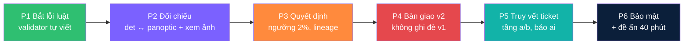

  

# Day 10 Lab — Nhóm 04

  
  
  
  
  

> **Không có đáp án để so.** Nhóm phải tự bắt lỗi, quyết định lô có được train không, bàn giao bản sửa mà không ghi đè bản cũ, và chỉ ra ai cần sửa khi team AI báo lỗi.

## Bạn sẽ làm gì

Nhóm nhận một lô 250 ảnh có cả nhãn **detection** và **panoptic**, cùng giấy tờ đi kèm (người gán, người kiểm, guideline, ticket của team AI). Trong lô có lỗi được gài theo seed. **Số lỗi mỗi loại thay đổi theo seed** và lô **không kèm nhãn gốc**.

| Việc | Công cụ |
|---|---|
| Bắt lỗi luật (file, hash, class, box, split, guideline) | **`validator/` do nhóm tự viết** |
| Đối chiếu detection ↔ panoptic, mở ảnh xem từng ứng viên | validator + `review_log.csv` |
| Quyết định Release / Hold theo ngưỡng 2%, ghi lineage | `lineage.py` |
| Bàn giao lô v2: manifest + sha256, label summary, truy vết, rework | `pack_release.py`, `check_handover.py` |
| Truy vết ticket: ảnh nào, tầng nào, báo ai | `trace.json` |
| Đo chính mình | `score_findings.py` (F1: báo thừa bị trừ như bỏ sót) |

## Lộ trình

## Bộ dữ liệu: 250 ảnh COCO, hai loại nhãn, một câu chuyện bàn giao

- **250 ảnh COCO val2017.** Mỗi ảnh có nhãn detection (YOLO, 80 lớp) và mask panoptic. Mọi máy tải ra cùng 250 ảnh.
- **Giấy tờ giả lập:** cảnh (5 ảnh/cảnh), job (25 ảnh/job) kèm người gán, người kiểm và phiên bản guideline (v1.2 rồi v1.3), changelog, và ticket của team AI.
- **Đề ẩn cuối buổi:** dùng **250 ảnh khác**, tên ảnh đã mã hoá, file đã ghi lại. Validator nào dựa vào nhãn gốc sẽ không có gì để so.

## Bắt đầu nhanh (5 bước)

1. Tạo repo nhóm từ repo này (tên: xem [SUBMISSION.md](SUBMISSION.md)), `git clone`. Kiểm Python: `python3 --version` (Windows: `py --version`) cần 3.10+. **Không cần `pip install`.**
2. Tải dữ liệu (một lần, khoảng 1 GB): `python scripts/download_public.py`
3. Tạo lô luyện tập cho nhóm: `python scripts/run_lab.py --seeds <seed của nhóm>`
4. Làm theo **[GUIDE.md](GUIDE.md)** từ **P1**. Đọc trước định dạng lô ở [docs/DELIVERY.md](docs/DELIVERY.md).
5. Trước khi nộp: `python scripts/check_handover.py --run runs/r<seed>` không còn FAIL.

> **Khi nộp:** làm theo checklist trong [SUBMISSION.md](SUBMISSION.md).

<b>Vì sao không có nhãn gốc để so?</b>

Ngoài đời, người kiểm chỉ có ảnh và nhãn được giao. Nếu có sẵn nhãn đúng thì đã không cần QC. Ở bản trước của lab, một script diff khoảng 40 dòng với nhãn gốc đạt điểm tối đa trên mọi seed. Bản này bỏ lối đó:
- Lỗi gán nhãn chỉ thấy khi **đối chiếu hai nguồn** (detection và panoptic của cùng ảnh).
- Sau đó phải **mở ảnh ra xem** để biết bên nào sai.

<b>Báo hết ứng viên cho chắc có được không?</b>

Không có lợi. Điểm là **F1**, nên báo thừa bị trừ như bỏ sót. Detection và panoptic của COCO vốn lệch nhau tự nhiên (vật bị che, crowd), nên với cách ghép thô, nhiều ứng viên **không phải lỗi**. Khi giảng viên thử bằng một validator ghép thô:

| Cách làm | F1 |
|---|---|
| Chỉ kiểm luật | khoảng 0,7 |
| Báo hết ứng viên mà không xem ảnh | khoảng 0,6 |
| Đối chiếu đúng cộng xem ảnh cẩn thận | trên 0,9 |

<b>PASS của <code>check_handover.py</code> có nghĩa là nhãn đúng không?</b>

Không. PASS chỉ nói lô v2 **đúng định dạng và nhất quán**: hash, số liệu, truy vết, ngưỡng, lineage. Nhãn đúng hay sai vẫn là việc của người xem ảnh.

<b>Mình dùng Windows / Mac thì sao?</b>

- **Windows (PowerShell):** gọi `py`, chạy từng lệnh riêng (không `&&`), thêm `-X utf8` nếu lỗi font.
- **macOS:** dùng `python3`. Script tự bỏ qua `.DS_Store`.
- **Mở ảnh để review:** dùng trình xem ảnh bất kỳ. Nếu muốn vẽ box lên ảnh thì tự viết thêm (Pillow là tuỳ chọn, không bắt buộc).

## Tài liệu

| Bạn cần | Xem |
|---|---|
| Các pha và lệnh chạy | [GUIDE.md](GUIDE.md) |
| Mốc tiến độ 4 giờ | [CHECKPOINTS.md](CHECKPOINTS.md) |
| Quy tắc làm bài, dùng AI | [RULES.md](RULES.md) |
| Chấm điểm (100 điểm) | [RUBRIC.md](RUBRIC.md) |
| Sản phẩm phải nộp, tên repo | [SUBMISSION.md](SUBMISSION.md) |
| Định dạng lô, các loại lỗi, format `errors.json` | [docs/DELIVERY.md](docs/DELIVERY.md) |
| Các script | [scripts/README.md](scripts/README.md) |
| Mẫu file phải điền | [templates/](templates/) |

## Bạn học được gì

- **Hai loại lỗi:** lỗi luật thì máy bắt được; lỗi gán nhãn thì cần **đối chiếu nguồn** và **mắt người**. Một F1 tổng cao có thể che việc bỏ sót loại thứ hai.
- **Đánh đổi precision/recall** khi không có đáp án: báo thừa cũng có giá.
- **Quyết định phát hành theo ngưỡng** (Day 7: trên 2% ảnh lỗi thì không Release) và ghi lại quyết định bằng **lineage**.
- **Bàn giao không ghi đè:** lô v2 có lô cha, có manifest + sha256, có hàng đợi gán lại giao đúng người.
- **Truy vết:** từ một ticket, khoanh vùng hai tầng ảnh cần mở lại và biết phải báo ai.
- **Hậu quả của lỗi đã train:** đổi dataset không tự sửa model đã học; phải xem lại hoặc train lại run bị ảnh hưởng.

Sơ đồ do giảng viên vẽ (`docs/assets/make_figures.py`). Ảnh dữ liệu: COCO val2017, xem [COCO terms of use](https://cocodataset.org/dataset/termsofuse.htm); annotation CC BY 4.0.
